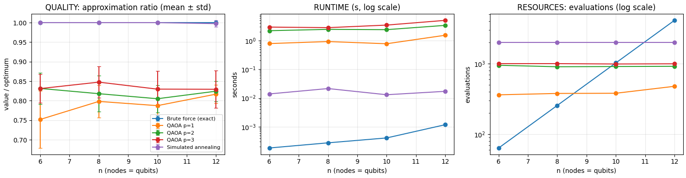

# Quantum Computing: From The Fundamentals to an Optimization Benchmark

In this repository I present four Python notebooks that cover from basic concepts to a final project: comparing **QAOA** with a classical method on an optimization problem (MaxCut), measuring quality, runtime and resources.

## Notebooks

| Notebook | Content | Colab |
|---|---|---|
| `01_quantum_basics` | Qubits, amplitudes, Bell-state and gates | [](https://colab.research.google.com/github/santiagomartin4424/quantum-computing/blob/main/01_quantum_basics.ipynb) |
| `02_deutsch_jozsa` | Deutsch-Jozsa Algorithm | [](https://colab.research.google.com/github/santiagomartin4424/quantum-computing/blob/main/02_deutsch_jozsa.ipynb) |
| `03_grover` | Grover's Search: oracle, diffusion and amplification | [](https://colab.research.google.com/github/santiagomartin4424/quantum-computing/blob/main/03_grover.ipynb) |
| `04_qaoa_maxcut_benchmark` | Main project (above) | [](https://colab.research.google.com/github/santiagomartin4424/quantum-computing/blob/main/04_qaoa_maxcut_benchmark.ipynb) |

## How to run

Open any notebook in Colab with the buttons above, or locally:

```bash
pip install -r requirements.txt
jupyter notebook
```

## Main project: QAOA vs. classical on MaxCut

**Problem:** split 8 delivery points into two shifts, separating the costliest conflicts. This is weighted MaxCut.



**What the notebook does**
- Formulates MaxCut as an Ising Hamiltonian (`cut = (W − E) / 2`) and validates it against brute force on every bitstring.
- Implements QAOA (p = 1–3) from scratch with NumPy (state-vector simulator), optimized with COBYLA.
- Compares it with simulated annealing and brute force on 10 random graphs per size (n = 6–12).

**Results** (ideal simulator, no noise)

| Method | Mean ratio | Runtime | Evaluations |
|---|---|---|---|
| Simulated annealing | ≈ 1.00 | ~15–20 ms | 2000 |
| QAOA (p = 1–3) | ≈ 0.75–0.85 | ~1–5 s | ~360–1000 |
| Brute force | 1.00 | milliseconds | 2ⁿ |

- The classical method wins on quality, runtime and resources at these sizes.
- QAOA amplifies good partitions by ~5 to ~70 times over random guessing, but that probability drops as *n* grows.
- Increasing *p* barely improves the ratio but noticeably improves the probability of measuring an optimum.

## Limitations and future work

- Ideal simulation, no noise; small sizes and a single graph family (Erdős–Rényi).
- QAOA runtime is CPU simulation time, not real quantum hardware time.
- Pending: noise model and mitigation (Qiskit Aer, ZNE), more graph families, MILP baselines (Pyomo + HiGHS) and Goemans–Williamson, VQE...
